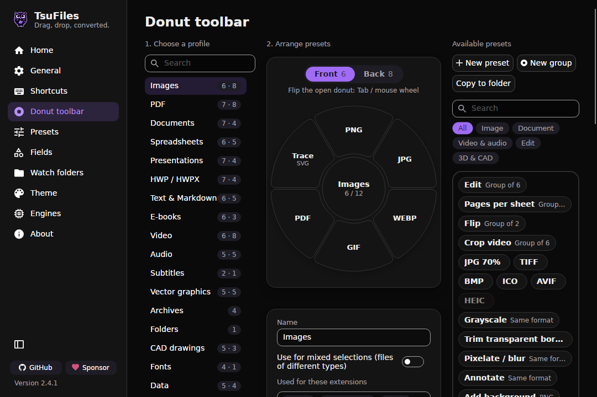

<p align="center"></p>

# TsuFiles

[](https://github.com/tsudev-org/tsufiles/releases/latest)
[](https://github.com/tsudev-org/tsufiles/actions/workflows/ci.yml)
[](LICENSE)
[](https://scorecard.dev/viewer/?uri=github.com/tsudev-org/tsufiles)

**An offline, free and open-source file converter - a Vietnamese-first, security-hardened fork of
[Filee](https://github.com/KnifeLemon/Filee).**

A [tsudev](https://tsudev.com) product. Vietnamese version: [README.md](README.md). Website: <https://files.tsudev.com>.

Drag a file and drop it on a format in the "donut" ring that opens under the pointer - that's it. More than 260
formats: images, PDF, Word, Excel, PowerPoint, HWP/HWPX, video, audio, e-books, archives, CAD, maps, 3D... Everything
runs **on your computer**: no file is uploaded anywhere, and Microsoft Office is not needed.

<p align="center"></p>

## Install

| System | Command |
| --- | --- |
| Windows (Scoop) | `scoop bucket add tsudev https://github.com/tsudev-org/scoop-bucket; scoop install tsudev/tsudev-files` |
| macOS (Homebrew) | `brew install --cask tsudev-org/tap/tsudev-files` |
| Debian, Ubuntu, Fedora, macOS | `curl -fsSL https://tsudev.com/install.sh \| sh -s -- tsudev-files` |

The one-line installer only adds the signed tsudev repository (APT/DNF, key fingerprint
`3883 10F4 7FA8 224D 76C0 A9C7 9745 B6AF 3EA3 3C74`) or the Homebrew tap and lets the package manager verify and install
the package; read it first at <https://tsudev.com/install.sh>. Manual downloads (Windows Setup/Portable, Linux tar.gz,
macOS dmg) are on [GitHub Releases](https://github.com/tsudev-org/tsufiles/releases/latest) with signed `SHA256SUMS`
and build provenance: `gh attestation verify <file> -R tsudev-org/tsufiles`.

## Links

- Download: <https://files.tsudev.com/tai-ve/> (or [GitHub Releases](https://github.com/tsudev-org/tsufiles/releases/latest))
- Bugs and ideas: <https://github.com/tsudev-org/tsufiles/issues>
- Security vulnerabilities: see [SECURITY.md](SECURITY.md) (do NOT open a public issue)
- Support the project: <https://files.tsudev.com/ung-ho/>

## How it differs from Filee

| Area | Filee | TsuFiles |
| --- | --- | --- |
| Default language | The operating system's, English as fallback | **Vietnamese** for the app, the installer and the CLI; changeable in Settings |
| `tsufiles` command line | English only | Vietnamese by default, `TSUFILES_LANG=en` for English; JSON keys unchanged for scripts |
| Product name | Filee | **TsuFiles**, owl logo, Night Owl theme ([ADR-0003](docs/adr/0003-ten-san-pham-tsufiles.md)); executable, `tsufiles` command, data folder, shortcuts and release files move to `tsufiles` in 2.4.1 with migration |
| Updates | `KnifeLemon/Filee` and its author's signing key | `tsudev-org/tsufiles` and **its own ECDSA P-256 signing key**; releases of other repositories are refused |
| GitHub Actions | Pinned by tag | **Pinned by commit SHA** |
| Security gates | CI + tests | Also CodeQL (security-extended), gitleaks, NuGet vulnerability audit, SBOM and build provenance, Dependabot |

Security architecture (Vietnamese): [docs/vi/KIEN-TRUC-BAO-MAT.md](docs/vi/KIEN-TRUC-BAO-MAT.md).

## Development

Requirements: .NET SDK 10 (`global.json`) and Git. Builds on Windows, Linux and WSL; the Windows installer builds only
on Windows ([docs/vi/PHAT-HANH.md](docs/vi/PHAT-HANH.md)). More in [CONTRIBUTING.md](CONTRIBUTING.md).

```bash
dotnet build TsuFiles.slnx
dotnet test tests/TsuFiles.Core.Tests    # and tests/TsuFiles.*.Tests
python3 -I tools/check_i18n_vi.py        # Vietnamese translation check
dotnet run --project src/TsuFiles.Cli -- help
```

Working conventions (for people and AI agents): read [AGENTS.md](AGENTS.md) first.

## Support

TsuFiles is free and will stay free. Every official way to support it is published only at
**<https://files.tsudev.com/ung-ho/>**; the app's "Sponsor" button and GitHub's "Sponsor" button both lead there.
Sponsors are listed here, on that page and on the app's About page.

<!-- sponsors: src/TsuFiles.App/Assets/Sponsors/sponsors.json -->

## License and credits

MIT. The [LICENSE](LICENSE) of Filee's authors ("Myeonggu Kim (KnifeLemon) and Filee contributors") is kept as the
license requires; all credit for the original software goes to [KnifeLemon/Filee](https://github.com/KnifeLemon/Filee)
and its contributors. Third-party components: [THIRD-PARTY-NOTICES.md](THIRD-PARTY-NOTICES.md).
